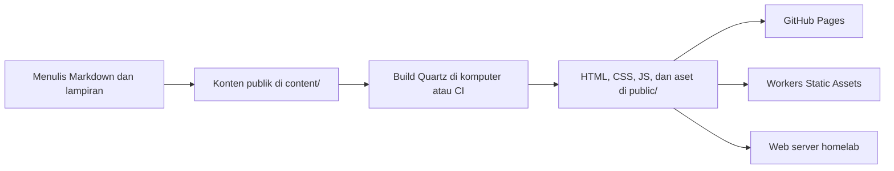

# Riset Quartz untuk knowledge library pribadi

Catatan ini merekam riset sebelum implementasi. Status instalasi lokal berikutnya tersedia di [README proyek](../README.md).

Ditinjau: 3 November 2026. Tujuan: menentukan dasar penulisan, pemeliharaan, dan deployment website untuk mengabadikan pembelajaran.

Dokumen ini memisahkan kemampuan yang didokumentasikan dari usulan untuk proyek. Verifikasi mencakup dokumentasi resmi, source upstream tertentu, dan prasyarat lokal. Build, tampilan browser, akun hosting, domain, serta kondisi homelab belum diuji.

## 1. Kesesuaian dengan tujuan

Quartz adalah static site generator yang mengubah Markdown menjadi website. Fitur yang relevan untuk arsip pembelajaran mencakup pencarian, backlinks, graph, pratinjau tautan, syntax highlighting, dan matematika. Ketersediaannya mengikuti template dan plugin yang diaktifkan. Sumber: [Quartz](https://quartz.jzhao.xyz/).

Filosofi digital garden menekankan catatan yang saling terhubung dan dapat diperbaiki seiring pemahaman berkembang. Ini cocok untuk menulis konsep, hasil eksperimen, dan hubungan antaride tanpa menunggu semuanya menjadi artikel panjang yang final. Sumber: [Philosophy of Quartz](https://quartz.jzhao.xyz/philosophy).

Penilaian untuk proyek ini: Quartz layak dicoba karena hasil belajar dapat disimpan sebagai berkas teks yang mudah ditinjau dan dicadangkan. Nilai utamanya akan datang dari isi, tautan antartulisan, dan kebiasaan memperbarui catatan. Graph adalah salah satu alat bantu penjelajahan.

## 2. Versi dan arsitektur

Dokumentasi yang diperiksa membahas Quartz 5. Source `package.json` pada branch upstream `v5` menyebut versi `5.0.0`, lisensi MIT, Node `>=22`, serta npm `>=10.9.2`. Referensi branch ini dapat berubah; saat implementasi, catat commit yang benar-benar digunakan. Sumber: [package.json upstream](https://github.com/jackyzha0/quartz/blob/v5/package.json).

Perubahan penting dari Quartz 4:

- Konfigurasi utama menjadi `quartz.config.yaml`.
- Layout dapat dideklarasikan melalui konfigurasi plugin.
- Plugin memiliki siklus pembaruan tersendiri.
- `quartz.ts` menyediakan override programatis untuk kebutuhan lanjutan.

Panduan lama yang memakai `quartz.config.ts` atau `quartz.layout.ts` perlu dicocokkan dengan versi proyek. Sumber: [What's New in Quartz 5](https://quartz.jzhao.xyz/getting-started/whats-new).

Alur teknisnya:



Build memakai Node.js dan pipeline transformasi, penyaringan, serta emisi berkas. Halaman dibuat menjadi HTML sebelum pengunjung membukanya; JavaScript di browser memberi interaksi tambahan. Implikasi arsitekturnya: penyajian website dasar tidak membutuhkan proses Node atau database yang terus berjalan. Sumber: [Architecture](https://quartz.jzhao.xyz/advanced/architecture).

## 3. Alur setup yang akan digunakan

Gunakan GitHub template resmi untuk membuat repository milik sendiri, lalu clone repository tersebut. Wizard menawarkan template `default`, `obsidian`, `ttrpg`, atau `blog`, serta pilihan konten baru, copy, atau symlink.

Di dalam checkout Quartz, urutan resmi untuk setup awal adalah:

```sh
npm install
npx quartz create
npx quartz plugin install --from-config
npx quartz build --serve
```

Preview tersedia di `http://localhost:8080`. Clone berikutnya menggunakan `npm ci` untuk dependency dari lockfile. `npx quartz sync` melakukan operasi Git termasuk commit dan push; jalankan setelah isi perubahan ditinjau. Sumber: [Installation](https://quartz.jzhao.xyz/getting-started/installation).

Usulan awal: gunakan template default atau obsidian, mulai dengan sedikit konten publik, lalu evaluasi alur menulis sebelum mengubah tampilan secara besar.

Hasil pemeriksaan lokal di workspace pada tanggal peninjauan:

| Komponen | Teramati |
| --- | --- |
| Workspace awal | Kosong; belum ada checkout Quartz atau repository Git |
| Node.js | `v24.14.0` |
| npm | `11.11.0` |
| Git | `2.54.0` |

Prasyarat versi terpenuhi. Keberhasilan instalasi dependency dan build masih perlu dibuktikan pada checkout yang dipilih.

## 4. Menulis dan menghubungkan pengetahuan

Konten halaman ditempatkan di `content/`; beranda berasal dari `content/index.md`. Obsidian adalah editor yang direkomendasikan dokumentasi, tetapi berkas Markdown dapat ditulis dengan editor lain. Frontmatter mendukung metadata seperti judul, deskripsi, tags, tanggal, aliases, dan permalink. Sumber: [Authoring Content](https://quartz.jzhao.xyz/getting-started/authoring-content).

Dukungan Obsidian mencakup wikilinks seperti `[[Nama Catatan]]`, embed, callout, dan diagram Mermaid melalui plugin terkait. Fitur plugin Obsidian tambahan perlu diperiksa tersendiri; sebagian membutuhkan ekspor atau plugin Quartz yang sesuai. Sumber: [Obsidian Compatibility](https://quartz.jzhao.xyz/features/obsidian-compatibility).

Usulan organisasi isi:

| Jenis tulisan | Kegunaan |
| --- | --- |
| Catatan singkat | Merekam satu temuan atau pelajaran kecil |
| Konsep | Penjelasan yang diperbaiki ketika pemahaman bertambah |
| Eksperimen/proyek | Menyimpan konteks, langkah, hasil, dan keterbatasan |
| Peta topik | Menuntun pembaca ke beberapa catatan terkait |

Folder dan tags sebaiknya sederhana dahulu. Tiap tulisan menjelaskan hal yang dipelajari, contoh yang membantu, sumber, serta kaitannya dengan catatan lain. Nama berkas yang unik membantu menghindari ambiguitas tautan.

Contoh usulan isi, setelah filter publikasi eksplisit dikonfigurasi:

```markdown
---
title: Mengapa validasi input diperlukan
description: Pelajaran dari sebuah eksperimen API.
date: 2026-11-03
tags:
  - software-engineering
publish: true
draft: false
---

Pemahaman saya saat ini adalah ...

## Contoh yang saya coba

Konteks, langkah, dan hasil ...

## Batasan pemahaman

Bagian yang masih perlu saya pelajari ...

## Kaitan

Lihat juga [[Penanganan error]].

## Sumber

Tautan ke dokumentasi atau bacaan asli.
```

`publish: true` pada contoh membutuhkan filter ExplicitPublish yang aktif. Penanda itu sendiri tidak mengubah kebijakan publikasi default.

## 5. Batas publikasi

Default RemoveDrafts menyaring catatan dengan `draft: true`. ExplicitPublish dapat dipakai agar hanya catatan dengan `publish: true` yang diterbitkan. Penyaringan Markdown ini tetap dapat membiarkan lampiran non-Markdown ikut masuk ke hasil build. `ignorePatterns` menyaring input build, sedangkan `.gitignore` berhubungan dengan pelacakan Git; repository publik dapat mengungkap sumber yang tidak tampil di website. Sumber: [Private Pages](https://quartz.jzhao.xyz/features/private-pages).

Usulan untuk proyek ini:

- Jadikan `content/` kumpulan materi yang sengaja dipilih untuk publikasi.
- Jika memakai vault pribadi, salin atau ekspor catatan beserta lampiran publik yang diperlukan ke area tersebut.
- Aktifkan publikasi eksplisit dan tinjau hasil `public/` sebelum peluncuran awal.
- Pastikan contoh draft dan lampirannya memang tidak muncul dalam output yang akan dikirim.

Ini merupakan keputusan alur kerja yang diusulkan. Pemakaian vault pribadi, folder terpisah, atau ekspor belum diputuskan pengguna.

## 6. Konfigurasi dan pemeliharaan

`baseUrl` diisi tanpa protokol. Contoh untuk project site GitHub Pages: `USERNAME.github.io/knowledge-library`; contoh domain sendiri: `notes.example.com`. Nilai ini memengaruhi URL absolut seperti sitemap dan RSS. Konfigurasi juga mengatur tema, locale, analytics, dan pola pengabaian input. Sumber: [Configuration](https://quartz.jzhao.xyz/configuration).

Usulan: tetapkan nama website, bahasa antarmuka yang tersedia, deskripsi, serta kebijakan analytics sebelum rilis. Pilih URL yang dapat dipertahankan. Bila hosting berganti, periksa canonical URL, feed, sitemap, dan redirect. Perubahan besar pada struktur folder perlu disertai peninjauan tautan.

Konfigurasi default upstream yang diperiksa sudah memakai sumber plugin npm seperti `"@quartz-community/search"`. Dokumentasi juga masih memberi contoh sumber GitHub. Keduanya didukung; untuk sumber npm, dependency dan `package-lock.json` harus ikut sesuai. Sumber: [Default configuration](https://github.com/jackyzha0/quartz/blob/v5/quartz.config.default.yaml) dan [Upgrading Quartz](https://quartz.jzhao.xyz/getting-started/upgrading).

Untuk plugin berbasis Git, `quartz.lock.json` mencatat versinya. `plugin install` memulihkan dari lockfile; `--from-config` menyinkronkan dengan konfigurasi dan dapat memangkas plugin yang tidak lagi dipakai; `--latest` mengambil pembaruan. Sumber: [Plugin CLI](https://quartz.jzhao.xyz/cli/plugin).

Usulan CI: simpan konfigurasi dan lockfile yang berlaku, gunakan instalasi yang dapat diulang, lalu build. Jalankan pembaruan inti atau plugin sebagai perubahan tersendiri yang dapat ditinjau dan dibatalkan. Batasi kustomisasi awal agar pemeliharaan tetap ringan.

## 7. Deployment

### GitHub Pages

Panduan Quartz menyediakan workflow GitHub Actions untuk instalasi dependency dan plugin, build, lalu publikasi `public/`. Pilih GitHub Actions sebagai publishing source dan sesuaikan branch trigger dengan branch repository yang sebenarnya. Sumber: [Quartz Hosting](https://quartz.jzhao.xyz/hosting#github-pages).

GitHub Free menyediakan Pages untuk repository publik; penggunaan repository privat bergantung pada paket yang mendukungnya. URL project site umumnya memiliki subpath nama repository. Sumber: [What is GitHub Pages?](https://docs.github.com/en/pages/getting-started-with-github-pages/what-is-github-pages).

Saat peninjauan, ukuran website terbit dibatasi 1 GB dan bandwidth memiliki soft limit 100 GB/bulan. Batas soft 10 build/jam tidak berlaku untuk custom GitHub Actions workflow. Sumber: [GitHub Pages limits](https://docs.github.com/en/pages/getting-started-with-github-pages/github-pages-limits).

Penilaian: kandidat awal yang sederhana untuk catatan publik bila alur kerja sudah menggunakan GitHub.

### Homelab

Salin hasil `public/` ke web server seperti Nginx atau Caddy. Server perlu mendukung URL tanpa ekstensi `.html`; contoh Nginx di dokumentasi memakai `try_files $uri $uri.html $uri/ =404;`. Sumber: [Quartz Self-Hosting](https://quartz.jzhao.xyz/hosting#self-hosting).

Serve mode dan contoh Docker bawaan ditujukan untuk preview lokal. Produksi sebaiknya menyajikan output build dengan web server. Sumber: [Docker Support](https://quartz.jzhao.xyz/features/docker-support).

Usulan: build di komputer atau CI, distribusikan artefak ke direktori rilis, lalu aktifkan rilis tersebut secara utuh. HTTPS dan jalur akses publik mengikuti konfigurasi homelab yang dipilih. Ketersediaan situs bergantung pada listrik, jaringan rumah, server, serta pengelolaan backup dan pembaruan. Belum ada inspeksi server dalam riset ini.

Penilaian: cocok bila pengoperasian hosting juga menjadi tujuan belajar.

### Cloudflare Workers Static Assets

Workers dapat menyajikan HTML, CSS, JavaScript, serta aset lain dan menangani caching. Website yang hanya menyajikan aset dapat bekerja tanpa Worker script khusus. Untuk Quartz, arahkan direktori aset ke hasil `public/`; proses build dilakukan sebelum upload. Ini adalah rancangan berdasarkan kemampuan produk, belum berupa deployment Quartz yang diuji. Sumber: [Workers Static Assets](https://developers.cloudflare.com/workers/static-assets/).

Gunakan perilaku Static Site Generation dengan halaman 404 yang benar. Nilai `not_found_handling: "404-page"` sesuai untuk output multipage Quartz. `enableSPA` pada Quartz memberi navigasi di browser; setiap halaman tetap memiliki output HTML, sehingga fallback semua URL ke beranda tidak diperlukan. Sumber: [Cloudflare SSG routing](https://developers.cloudflare.com/workers/static-assets/routing/static-site-generation/) dan [Quartz Architecture](https://quartz.jzhao.xyz/advanced/architecture).

Default `html_handling: "auto-trailing-slash"` melayani `catatan.html` melalui `/catatan` dan folder index melalui path berakhiran slash. Uji perilakunya dengan output nyata Quartz. Sumber: [HTML handling](https://developers.cloudflare.com/workers/static-assets/routing/advanced/html-handling/).

Saat peninjauan, request yang langsung menyajikan static assets gratis dan tidak dibatasi jumlah request. Eksekusi Worker script mengikuti biaya dan batas Workers; pipeline build juga perlu ditinjau tersendiri. Sumber: [Billing and Limitations](https://developers.cloudflare.com/workers/static-assets/billing-and-limitations/).

Batas static assets saat peninjauan: 20.000 berkas per versi untuk Free, 100.000 untuk Paid, dan 25 MiB per berkas. Yang dihitung mencakup semua output, termasuk gambar, halaman tags, serta aset pendukung. Sumber: [Workers platform limits](https://developers.cloudflare.com/workers/platform/limits/#static-assets).

Penilaian: kandidat kuat bila menginginkan managed hosting dan ruang untuk integrasi Cloudflare berikutnya. Panduan Quartz yang diperiksa mencontohkan Cloudflare Pages; konfigurasi Workers perlu disusun mengikuti dokumentasi Cloudflare saat implementasi.

### Perbandingan praktis

| Pertimbangan | GitHub Pages | Homelab | Workers Static Assets |
| --- | --- | --- | --- |
| Artefak yang dilayani | Output `public/` | Output `public/` | Output `public/` |
| Pengelolaan server | Dikelola penyedia | Dikelola sendiri | Dikelola penyedia |
| Ketergantungan jaringan rumah | Tidak | Ya | Tidak |
| Alur rilis usulan | Push → Actions → Pages | Build → transfer → aktivasi rilis | Push/build → upload assets |
| Alasan memilih | Alur GitHub sederhana | Belajar dan mengendalikan infrastruktur | Managed hosting dan integrasi Cloudflare |

Ketiganya tetap memungkinkan sumber Markdown yang sama. Usulan awal adalah membuktikan alur menulis dan build dahulu; pilihan hosting dapat mengikuti kebutuhan operasional.

## 8. Fitur tambahan yang perlu dipilih secara sadar

Pencarian Quartz memakai FlexSearch dan membutuhkan ContentIndex. Indeks berisi konten halaman untuk membantu pencarian, sehingga pemeriksaan publikasi sebaiknya mencakup indeks yang dihasilkan. Sumber: [Full-text Search](https://quartz.jzhao.xyz/features/full-text-search).

Komentar dapat memakai Giscus dengan GitHub Discussions dan repository publik yang sesuai. Ini menambah integrasi pihak ketiga. Sumber: [Comments](https://quartz.jzhao.xyz/features/comments).

Usulan awal: cukup gunakan pencarian, navigasi, backlinks, dan tampilan baca yang nyaman. Tunda komentar atau fitur tambahan sampai kebutuhan jelas. Kompres gambar dan beri teks alternatif. Untuk tulisan yang berasal dari bacaan, tulis pemahaman sendiri dan cantumkan sumber. Simpan cadangan konten serta lampiran yang dibutuhkan untuk membangun ulang situs.

## 9. Tahap implementasi berikutnya

Urutan yang diusulkan:

1. Tentukan nama, bahasa tulisan, editor, dan kumpulan konten publik pertama.
2. Pilih checkout Quartz 5 dan catat revisinya, lalu jalankan setup.
3. Konfigurasikan publikasi eksplisit, identitas situs, dan URL target.
4. Buat 3–5 catatan nyata yang mencakup tautan, gambar, kode, dan satu halaman peta topik.
5. Build dan periksa isi output, tautan langsung, pencarian, tampilan ponsel, serta halaman 404.
6. Siapkan satu jalur deployment dan verifikasi situs terbit pada URL sebenarnya.

Kriteria keberhasilan awal: menulis dan memperbarui catatan terasa sederhana, sumber dapat dicadangkan, hasil publikasi sesuai pilihan, serta catatan dapat ditemukan melalui navigasi dan tautan.

Keputusan yang masih terbuka: nama/domain, editor, hubungan dengan catatan pribadi, struktur isi awal, dan pilihan hosting. Ini dapat diputuskan ketika implementasi dimulai.
