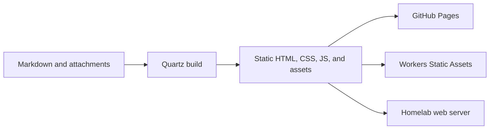

# Initial research: Quartz for a personal knowledge library

This document records the research conducted before implementation on November 3, 2026. Some proposals and observations describe that point in time; see the [project README](../README.md) for the current setup. At the time of this research, the local workspace was empty, and installation, the browser preview, hosting accounts, domains, and the homelab had not yet been tested.

## Fit and architecture

[Quartz](https://quartz.jzhao.xyz/) is a static site generator that turns Markdown into a website. Depending on the configured plugins, it supports search, backlinks, a graph, link previews, syntax highlighting, and mathematics. Its [digital garden philosophy](https://quartz.jzhao.xyz/philosophy) suits notes that can be linked and refined as understanding develops.

The reviewed upstream `v5` branch identified Quartz 5.0.0 and required Node.js 22 or newer and npm 10.9.2 or newer. Quartz 5 uses `quartz.config.yaml`, plugin-based layout, and optional programmatic overrides in `quartz.ts`; older Quartz 4 instructions require adaptation. See the [upstream package](https://github.com/jackyzha0/quartz/blob/v5/package.json), [Quartz 5 changes](https://quartz.jzhao.xyz/getting-started/whats-new), and [architecture](https://quartz.jzhao.xyz/advanced/architecture).

Node.js is needed for the build, but serving the generated static site does not require a continuously running Node process or database. The initial machine inspection found Node `v24.14.0`, npm `11.11.0`, and Git `2.54.0`.

## Writing and publication

Content lives in `content/`, with `content/index.md` as the home page. Markdown can be edited in Obsidian or another editor. Quartz's relevant plugins support wikilinks, embeds, callouts, and Mermaid; compatibility with additional Obsidian plugins should be checked individually. See [authoring content](https://quartz.jzhao.xyz/getting-started/authoring-content) and [Obsidian compatibility](https://quartz.jzhao.xyz/features/obsidian-compatibility).

The proposed organization combined short findings, concept notes, experiment notes, and topic maps. A public collection should contain only deliberately selected material. `RemoveDrafts` and `ExplicitPublish` filter Markdown, but non-Markdown attachments may still enter the build. Build exclusions and Git exclusions serve different purposes; a public repository may expose source files even when they are not rendered. See [Private Pages](https://quartz.jzhao.xyz/features/private-pages).

A note proposed for explicit publication would contain frontmatter such as `publish: true` and `draft: false`, alongside its explanation, example, limitations, related notes, and sources. That frontmatter requires the corresponding filter to be enabled.

## Configuration and maintenance

The documented `baseUrl` omits the protocol and affects absolute URLs, including sitemap and RSS links. A GitHub Pages project site uses a path such as `USERNAME.github.io/knowledge-library`; a custom domain uses a host such as `notes.example.com`. Review canonical URLs, feeds, links, and redirects when changing hosting. See [configuration](https://quartz.jzhao.xyz/configuration).

The reviewed configuration used npm-based plugins, which require appropriate dependencies and `package-lock.json`. Git-based plugins use `quartz.lock.json`; plugin installation and update options are described in the [plugin CLI documentation](https://quartz.jzhao.xyz/cli/plugin). A repeatable CI build and separately reviewable upstream updates were recommended.

## Hosting options considered

| Option | Approach | Main consideration |
| --- | --- | --- |
| GitHub Pages | Build with Actions and publish `public/` | Straightforward workflow for a public GitHub repository |
| Homelab | Serve `public/` with a web server | Direct control and an opportunity to learn operations |
| Workers Static Assets | Build and upload `public/` as static assets | Managed hosting and possible Cloudflare integration |

The [Quartz hosting guide](https://quartz.jzhao.xyz/hosting) provides a GitHub Actions workflow and self-hosting examples. A homelab server must handle extensionless HTML paths; production should serve the generated files rather than use the development preview. Availability depends on the home network, power, server maintenance, and backups.

A Workers Static Assets deployment was a design based on Cloudflare's documented capabilities, not a tested deployment. Quartz emits multiple HTML pages, so static-site routing with an appropriate 404 page is a better starting point than an SPA fallback that sends every missing route to the home page. Check current [Static Assets documentation](https://developers.cloudflare.com/workers/static-assets/), [SSG routing](https://developers.cloudflare.com/workers/static-assets/routing/static-site-generation/), [billing](https://developers.cloudflare.com/workers/static-assets/billing-and-limitations/), and [limits](https://developers.cloudflare.com/workers/platform/limits/#static-assets) before deployment.

## Further choices

Search indexes page content, so publication checks should include generated indexes. Comments and other integrations can be added when there is a clear need. Images should be compressed and given alternative text; externally sourced ideas should be attributed. See [Quartz search](https://quartz.jzhao.xyz/features/full-text-search) and [comments](https://quartz.jzhao.xyz/features/comments).

The initial recommendation was to start with a small collection, configure explicit publication, verify build output and navigation, and then choose one deployment path. These were proposals at research time; implementation decisions and current deployment status belong in the README.
